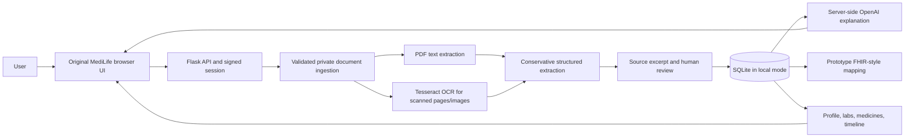

# MediLife Health Copilot

MediLife is a hackathon prototype for organizing medical documents and explaining record-supported findings in plain language. It is not a clinical service, diagnosis tool, or substitute for a clinician.

## Public demo

- App: [https://medilife-health-copilot.onrender.com/](https://medilife-health-copilot.onrender.com/)
- Health: [https://medilife-health-copilot.onrender.com/health](https://medilife-health-copilot.onrender.com/health)
- The public Render free service uses an ephemeral filesystem. It is configured as a **synthetic-data demo**: it blocks account and record writes, and the browser-only sample workspace is clearly labeled. Never enter or upload personal health information there.
- Free Render web services can spin down after 15 minutes idle and take about a minute to wake. Free filesystem changes are lost on restarts, deploys, and spin-down. Durable personal records require an approved paid persistent-storage design; no paid resource is created by this repository.
- Health reports only whether an AI key is present, the demo-mode status, and Render's commit identifier. It never returns a secret.

## Implemented

- Responsive HTML/CSS/JavaScript interface with English and Telugu labels, dark mode, accessible navigation, and a synthetic sample workspace.
- Flask API with password hashing, signed sessions, owner-scoped record access, upload validation, duplicate detection, protected file reads, user-initiated account deletion, and per-document deletion.
- PDF text extraction with PyMuPDF; scanned PDF/image OCR through Tesseract when installed. Failed OCR is reported as a failure, not success.
- Conservative extraction of common lab rows and prescription lines, with source excerpts and user review/correction.
- Source-grounded OpenAI summary and copilot endpoints, when configured with a server-side key. Provider failures are distinct from a missing key.
- Profile, document list, lab results, medicines, timeline, and a prototype FHIR-style export. This is not an official FHIR server, ABDM connection, or ABHA verification service.

Extraction is heuristic and not clinically validated. Automated diagnosis, allergy, and medical-history extraction, OCR confidence scoring, persisted chat, comprehensive laboratory comparability, production rate limiting, and formal FHIR validation are not implemented. Current-use status for medicines is not inferred from old prescriptions.

## Architecture



The public free deployment deliberately disables personal-data writes because its local SQLite database and uploaded files are ephemeral. Production storage is not configured. A durable deployment needs a managed database plus private durable file storage (or an approved paid persistent disk for this single-instance prototype), backups, and a security review.

## Run locally

Requires Python 3.10+, Node.js for the JavaScript syntax check, and Tesseract installed separately for OCR.

```powershell
python -m venv .venv
.\.venv\Scripts\Activate.ps1
python -m pip install -r requirements.txt
Copy-Item .env.example .env
python app.py
```

Open `http://127.0.0.1:5000`. Local mode defaults to `MEDILIFE_DEMO_MODE=0`; use synthetic records only. Set a unique `FLASK_SECRET_KEY`. Set `OPENAI_API_KEY` locally or in the backend host to enable actual AI calls. Never put it in frontend code or commit `.env`.

## Environment variables

| Name | Purpose |
| --- | --- |
| `FLASK_SECRET_KEY` | Flask session signing secret; use a unique strong value |
| `DATABASE_PATH` | SQLite file path (local/single-instance only) |
| `UPLOAD_DIR` | Private source-file directory |
| `OPENAI_API_KEY` | Optional, server-side provider credential |
| `OPENAI_MODEL` | OpenAI model; defaults to `gpt-4o-mini` |
| `MAX_UPLOAD_MB` | Maximum accepted document size; defaults to 15 |
| `COOKIE_SECURE` | Set `1` behind HTTPS |
| `MEDILIFE_DEMO_MODE` | `1` blocks API writes for the ephemeral public demo |

## Tests

```powershell
python -m unittest discover -s tests -v
python -m py_compile app.py tests/test_app.py
node --check static/app.js
```

Tests use synthetic data. Digital PDF extraction is tested with PyMuPDF. OCR requires the Tesseract executable; provider success requires a real server-side key and is not claimed as tested here. Provider failure, missing-key, data-isolation, upload, deletion, timeline, and FHIR-style serialization paths have automated coverage.

## Render deployment

The `render.yaml` Blueprint uses the Dockerfile, Gunicorn, `/health`, and a Render-generated session secret. `OPENAI_API_KEY` is declared as a dashboard-supplied secret (`sync: false`). Saving it with **Save, rebuild, and deploy** or **Save and deploy** restarts the service with the new environment. Confirm `ai_configured: true` at `/health`; this checks only presence and does not validate the key or provider quota. Then confirm the health response's `release` matches the intended commit.

Render's free tier cannot attach persistent disks and loses local files on restarts/spin-down. The Blueprint intentionally sets `MEDILIFE_DEMO_MODE=1`; the application also defaults to demo-only when running on Render and that setting is absent. To enable real user records, first approve and configure durable managed database and private file storage, backups, and production controls. Only then should the operator explicitly set `MEDILIFE_DEMO_MODE=0` and deploy. Do not use real patient data until that work and a security review are complete.

## Privacy and safety

Uploaded text sent for a summary or chat question goes to the configured AI provider. API keys remain server-side. User data is owner-scoped, source files are not served as static assets, and account/document deletion endpoints are authenticated. The public demo accepts synthetic sample data only. This project has not undergone a compliance audit, clinical validation, penetration test, or formal healthcare-regulatory review.

## Demo walkthrough

1. Open the public URL and choose **Explore clearly labelled sample data**.
2. Show the fictional CBC and prescription, source-reported low flag, source references, profile, medicines, labs, and timeline.
3. Switch English/Telugu and explain that the sample explanation is precomputed, not a live AI response.
4. Visit Settings to show the prototype FHIR-style export description; no ABDM/ABHA service is connected.
5. For a live AI demonstration, use a properly configured local environment or a durable approved deployment, upload only synthetic records, and verify the real API response.
