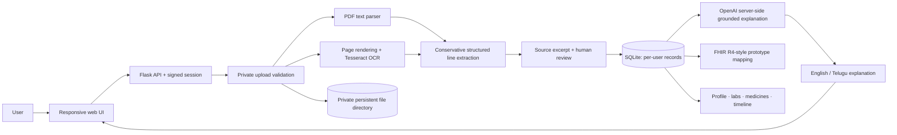
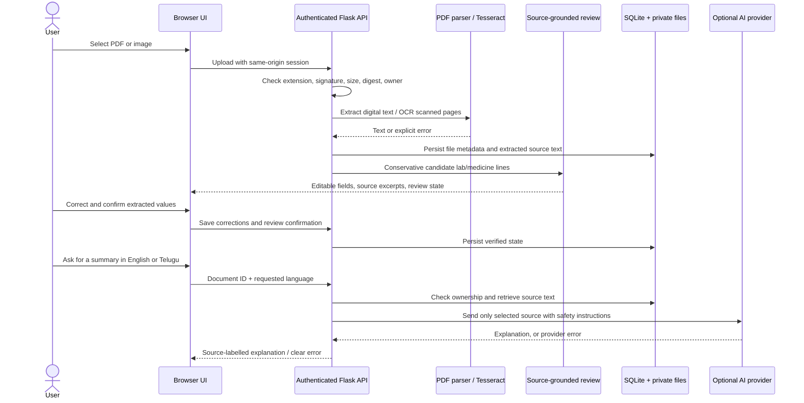

# MediLife — personal health copilot prototype

MediLife is a responsive, single-service web application for private medical-record organization. It stores account-scoped profile and document metadata in SQLite, keeps uploaded files on a private filesystem path, and only offers AI explanations when a server-side provider key is configured. It is a hackathon prototype, not a clinical service.

> **Workspace note:** The expected `MediLife-main` source was not present in the supplied `D:\Medilife` folder. This implementation was created in that empty folder. No neighboring project was modified.

## Cloud deployment status (2026-10-11)

A separate Hatchable-hosted release is deployed at [https://medilife-health.hatchable.site](https://medilife-health.hatchable.site), project `medilife-health`. Its health endpoint is [https://medilife-health.hatchable.site/api/status](https://medilife-health.hatchable.site/api/status). The host provisions PostgreSQL, email-code accounts, and private object storage. The project is currently **private**; the owner must switch visibility to Public in [Hatchable project settings](https://hatchable.com/console/projects/medilife-health).

The hosted implementation is a separate serverless JavaScript project, not this local Flask service. It currently supports per-account records and profile, private document storage and owner-checked reads, PostgreSQL row ownership policies, a prototype FHIR export, and an English/Telugu interface. OCR and AI are intentionally disabled because the proposed Gemini processor would receive uploaded medical documents and that data destination has not been approved. Uploads are stored as `uploaded`, not marked processed. Real OCR/AI, provider setup, and end-to-end health-document workflows remain incomplete in the hosted release.

## Start locally

1. Install Python 3.10+.
2. Create and activate a virtual environment.
3. Install the pinned-range dependencies: `python -m pip install -r requirements.txt`.
4. Copy `.env.example` to `.env`; set a unique `FLASK_SECRET_KEY`.
5. Install Tesseract OCR separately and make its executable available to the server if scanned images/PDFs should be OCR'd.
6. Start the app with `python app.py` and open `http://127.0.0.1:5000`.
7. Create an account (password length: 10 characters minimum), upload a synthetic test report, inspect its extraction status, and review any detected fields.

PyMuPDF extracts digital PDF text. For a scanned PDF, the app renders each textless page and sends that image through the configured local Tesseract installation. JPG/PNG OCR uses Tesseract. Missing engines and unreadable documents produce an explicit failure state; the application does not claim OCR succeeded. `OPENAI_API_KEY` is optional and must stay server-side. When configured, selected document text or relevant excerpts are sent to the configured AI provider for explanations; the copilot UI discloses this. Without a key, summary/chat returns a configuration error and leaves records untouched.

## Architecture



### Upload and explanation data flow



## Data model and FHIR mapping

SQLite tables: `users`, `profiles`, `documents`, `observations`, `medications`, `conditions`, `conversations`, and `messages`. Foreign keys cascade on account deletion; owner-scoped queries are used for document, source-file, lab, medicine, profile, summary, and export access. Uploaded filenames are sanitized for display and storage names are random identifiers. Duplicate content per account is rejected by SHA-256 digest.

The `/api/fhir` endpoint emits a clearly labelled prototype R4-style collection: `Patient` (account email and UUID identifier), `DocumentReference`, `Observation` (source value, source range, source document), `MedicationRequest` (unknown status and source note), and `Condition` when one exists. The current extractor does not create condition records. This is not a validated FHIR server, ABDM connection, ABHA workflow, or official health identifier service.

## Run checks

```powershell
python -m unittest discover -s tests -v
python -m py_compile app.py tests/test_app.py
node --check static/app.js
```

Tests cover the health endpoint, registration validation, per-account isolation, upload type and duplicate checks, the truthful OCR-unavailable state, private file access, provider-unconfigured behavior, and authenticated FHIR-style output. No real OCR or AI provider was available in the development environment, so provider-success paths and clinical extraction accuracy are not asserted as passed.

## Deployment preparation

`render.yaml` prepares a Python/Docker Render service with a health check, generated session secret, secure cookies, and persistent private disk for SQLite and source files. No Render service is deployed: this workspace is not a Git repository, and no GitHub/Render authorization or credentials are available. To deploy this Python application, publish it to a private GitHub repository, connect that repository to Render, and create the web service from `render.yaml`. Configure `OPENAI_API_KEY` in Render's server-side secret settings only if AI summaries and copilot answers are desired. The container installs Tesseract for scanned images and PDFs; deployment OCR has not been verified because Docker is unavailable here. This SQLite + single persistent disk design is a single-instance hackathon deployment, not a highly available clinical system.

Local automated checks passed on 2026-10-11: 7 unittest cases, Python compilation, and JavaScript syntax check. The digital-PDF test creates and extracts a synthetic report, persists its reviewable lab value, verifies timeline inclusion and private file access, and confirms missing AI credentials produce an error. A local Flask process started, but the execution sandbox denied HTTP socket access, so an HTTP health request from this environment was not verified. The cloud Hatchable checks and limitations are listed above. No public Render URL or production end-to-end workflow has been verified. Never upload real patient documents to an unreviewed deployment.

## Feature status and limits

- Implemented: responsive navigation/layout, English/Telugu interface labels, light/dark appearance, registration/login/logout, account-scoped SQLite records, document upload with progress, type/signature/size checks, duplicate detection, private file route, retry, text extraction when optional engines are present, conservative reviewable lab/medicine candidates, profile edits, labs, medicines, timeline, AI summary/chat integration, sample workspace kept in browser-only state, account deletion, FHIR-style export, and health endpoint.
- Demo content: fictional lab and prescription entries, marked **SAMPLE** and **precomputed**. They do not enter personal storage and are not represented as AI-generated.
- Not implemented: clinical-grade extraction/accuracy, handwritten OCR, automated document date/diagnosis/allergy extraction, persisted chat history, PostgreSQL/object-storage production architecture, rate limiting, clinician workflows, formal audit logging, formal FHIR validation, ABDM/ABHA integration, and deployment verification.
- The UI/API are same-origin; no broad CORS policy is enabled. Production must set a strong secret and secure cookies. This prototype should receive a security review before handling real medical data.

## Judge walkthrough (about 2 minutes)

1. Choose **Explore sample workspace** from sign-in to see the clearly marked fictional CBC, prescription, source flag, English/Telugu precomputed explanation, and timeline without mixing demo and personal data.
2. Sign out, create a demo account, upload a synthetic PDF or image, and observe the real server extraction status. With OCR dependencies absent, the application shows a truthful failed state and retry action.
3. Review any candidate fields and source excerpt; correct values and explicitly confirm them.
4. Visit Labs, Medicines, Timeline, and Health Profile to see the same saved records and provenance.
5. Enable the server-side AI key in a configured deployment to generate a source-grounded English or Telugu summary and ask a record-specific question.
6. Show the prototype FHIR export and `/health` endpoint. Explain that ABDM connectivity is future work and that a persisted database/object store and provider credentials are needed for production.
